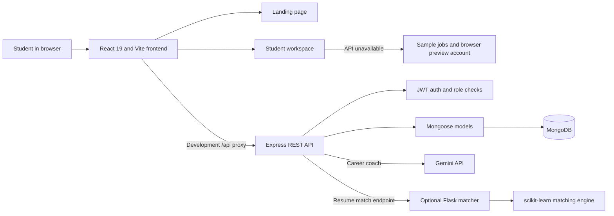
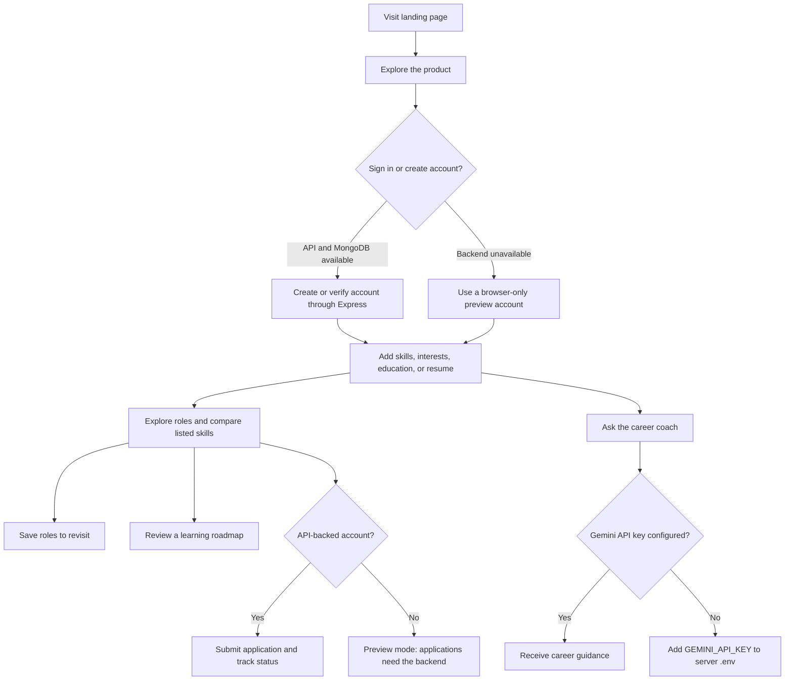

# SkillBridge

SkillBridge helps students connect the skills they already have to early-career roles, understand what they could learn next, and keep their job search organized.

It includes a public landing page, a student career workspace, role matching, saved roles, an application tracker, a skills roadmap, resume skill extraction, and an optional Gemini career coach.

> **Project status:** MVP / local development. The frontend can run in browser preview mode without a database. Real accounts, job listings, and applications require the Express API and MongoDB. The AI career coach also requires a Gemini API key.

## Contents

- [Highlights](#highlights)
- [Tech stack](#tech-stack)
- [Try the demo](#try-the-demo)
- [Run the frontend preview](#run-the-frontend-preview)
- [Deploy on Vercel](#deploy-on-vercel)
- [Run the full application](#run-the-full-application)
- [Configuration](#configuration)
- [How the application works](#how-the-application-works)
- [Architecture](#architecture)
- [Student workflow](#student-workflow)
- [API reference](#api-reference)
- [Project structure](#project-structure)
- [Tests](#tests)
- [Current limitations and next steps](#current-limitations-and-next-steps)
- [Security notes](#security-notes)

## Highlights

- Explore and filter early-career jobs by search term, location, employment type, and experience level.
- Compare profile skills with a job’s listed requirements. The match score is a skills overlap guide, not a hiring probability.
- Save roles, update a profile, submit applications, and review submitted applications when using the API-backed experience.
- Generate a practical learning roadmap from skills requested by open roles.
- Extract supported skills from a text or PDF resume in the browser.
- Ask the optional Gemini career coach for beginner-friendly guidance grounded in current role listings.
- Switch between light and dark themes. Landing and workspace motion respects reduced-motion preferences.
- Continue exploring with sample listings and a browser-only student account when the API is unavailable.

## Tech stack

| Area | Current implementation |
|---|---|
| Frontend | React 19, Vite 8, JavaScript ES modules |
| Styling and icons | CSS, CSS custom properties, Lucide React |
| Motion | GSAP + ScrollTrigger, Framer Motion, Anime.js |
| API | Node.js, Express 4 |
| Database and models | MongoDB, Mongoose |
| Authentication | JSON Web Tokens, bcryptjs password hashing |
| Resume processing | PDF.js and browser-side text extraction |
| AI career coach | Gemini API, called from the Express server |
| Optional resume matching service | Python, Flask, scikit-learn |

**Note:** The repository currently uses Vite and JavaScript. It is not a Next.js, TypeScript, or Tailwind project today.

## Try the demo

Open the site, select **Sign in**, then choose **Use the student demo account**. Or enter these credentials:

| Field | Value |
|---|---|
| Email | `demo@skillbridge.local` |
| Password | `SkillBridgeDemo123!` |

This creates a student preview account in the current browser. Its profile and saved roles stay in that browser and do not sync to MongoDB, another browser, or another device. Applications need the API-backed experience.

There is also a **backend-only** recruiter seed account for local API development. It does not have a recruiter dashboard in the current frontend:

| Field | Value |
|---|---|
| Email | `demo-recruiter@skillbridge.local` |
| Password | `DemoRecruiter123!` |

The recruiter account and sample jobs are created by `npm run seed` and require MongoDB. Treat these credentials as local-development-only.

## Run the frontend preview

The preview is the quickest way to explore the interface and student demo account. It does not require MongoDB, Python, or the Express server.

**Requirements:** Node.js 20.19+ or 22.12+, and npm.

```bash
npm install
npm run dev
```

Open the local URL printed by Vite, usually `http://localhost:5173`. If that port is already in use, Vite may choose another port.

When the backend is unavailable, the dashboard uses clearly labelled sample jobs. Sign-up and sign-in can use browser preview accounts. API-backed actions such as submitting an application are not available in this mode.

## Deploy on Vercel

For the quickest public preview, import `the-nidhi-bhat/Skill-Bridge-` as a **single Vite project**. In the import screen, choose the Vite app at the repository root (`./`) and do not enable multi-service mode. Vercel's multi-service suggestion detects the optional Flask matcher but does not configure this project's Express API, MongoDB, or Gemini key; deploying that suggestion as-is would leave account and application features disconnected.

Use the Vite preset and the defaults from `package.json`: build command `npm run build`, output directory `dist`. The root `vercel.json` provides the SPA rewrite needed for direct visits to `/dashboard` and other client-side paths. With no API URL configured, the deployment runs in browser preview mode with fictional jobs and local preview accounts.

For real accounts and applications, deploy the Express API as a separate Node web service (for example, Render) and use MongoDB Atlas for its database. Configure the API service with `MONGO_URI`, a unique `JWT_SECRET`, and `CLIENT_URL` set to the deployed Vercel origin. Then set Vercel's `VITE_API_BASE` to the API's HTTPS origin, without a trailing `/api`, and redeploy. `GEMINI_API_KEY` is optional and belongs only in the API service's environment. The Python matcher is optional and can be deployed separately if the resume-to-job matching endpoint is needed.

The demo recruiter credentials and `npm run seed` are intended for local development; do not seed the public database with the demo recruiter account.

## Run the full application

### 1. Install dependencies

```bash
npm install
```

### 2. Configure environment variables

Copy the example file:

```powershell
# Windows PowerShell
Copy-Item .env.example .env
```

```bash
# macOS / Linux
cp .env.example .env
```

Set a unique `JWT_SECRET` and confirm `MONGO_URI`. Add `GEMINI_API_KEY` only if you want to enable the career coach. See [Configuration](#configuration).

### 3. Start MongoDB

Start your local MongoDB service or provide a MongoDB connection URI in `.env`. The API and seed script both need a reachable database.

### 4. Seed sample roles

```bash
npm run seed
```

This creates a local recruiter account and three fictional sample jobs. Seeding does not overwrite jobs already posted by that recruiter.

### 5. Start the API

In one terminal:

```bash
npm run server:dev
```

The Express API listens on port `5000` by default. It exits with a configuration or database connection error if required values are missing or MongoDB cannot be reached.

### 6. Start the frontend

In another terminal:

```bash
npm run dev
```

Vite proxies `/api` calls to `http://127.0.0.1:5000`. The frontend normally runs at `http://localhost:5173`.

### Production-style local run

Build the frontend, then start Express. Express serves the built `dist/` files and API from the same origin:

```bash
npm run build
npm start
```

The production-style run still requires `.env` and a reachable MongoDB database.

## Configuration

| Variable | Required | Purpose |
|---|---:|---|
| `PORT` | No | Express port; defaults to `5000`. |
| `MONGO_URI` | Yes for API | MongoDB connection string. Example: `mongodb://127.0.0.1:27017/skillbridge`. |
| `JWT_SECRET` | Yes for API | Long, unique secret used to sign authentication tokens. Replace the placeholder before starting the server. |
| `JWT_EXPIRES_IN` | No | Token lifetime; defaults to `1d`. |
| `CLIENT_URL` | No | Allowed browser origin for Express CORS. Example: `http://localhost:5173`. |
| `GEMINI_API_KEY` | No | Enables Gemini career-coach replies. Keep this server-side; never expose it as a `VITE_*` value. |
| `AIML_SERVICE_URL` | No | Optional Flask matcher URL; defaults to `http://127.0.0.1:8000`. |
| `VITE_API_BASE` | No | Frontend API base URL when the API is hosted on a different origin. Leave empty for the local Vite proxy or same-origin production setup. |

Generate a local JWT secret with Node.js:

```bash
node -e "console.log(require('node:crypto').randomBytes(48).toString('hex'))"
```

Never commit `.env` or real API keys. `.env.example` contains placeholders only.

## How the application works

The Vite frontend serves the landing page and dashboard. In development it proxies `/api` to Express. Express validates requests, checks JWTs and roles, and reads or writes MongoDB through Mongoose. The career coach calls Gemini from the server; the optional resume-matching endpoint calls the Flask service.

If the API cannot be reached, the frontend provides a preview experience with sample roles and local preview authentication. This fallback is intended for trying the UI; it is not a replacement for server-backed accounts.

## Architecture



## Student workflow



## API reference

All paths below are prefixed with `/api`. Protected routes expect `Authorization: Bearer <token>`.

| Method | Route | Access | Description |
|---|---|---|---|
| `GET` | `/health` | Public | Reports API and MongoDB connection status. |
| `POST` | `/auth/register` | Public | Creates a student account and returns a token. |
| `POST` | `/auth/login` | Public | Verifies credentials and returns a token. |
| `GET` | `/auth/me` | Authenticated | Reads the signed-in profile. |
| `PATCH` | `/auth/me` | Authenticated | Updates name, education, and skills. |
| `PATCH` | `/auth/me/saved-jobs` | Authenticated | Replaces saved open job IDs. |
| `GET` | `/jobs` | Public | Lists open roles; supports search, location, type, experience, page, and limit filters. |
| `GET` | `/jobs/:id` | Public | Reads one open role. |
| `POST` | `/jobs` | Recruiter/admin | Creates a job listing. |
| `PATCH` | `/jobs/:id` | Listing owner/admin | Updates a job listing. |
| `DELETE` | `/jobs/:id` | Listing owner/admin | Deletes a job listing. |
| `POST` | `/applications` | Student | Applies to an open role. Body includes `jobId` and optional `coverLetter` or `resumeUrl`. |
| `GET` | `/applications/mine` | Student | Lists the signed-in student’s applications. |
| `POST` | `/ai/match` | Public | Matches resume text against MongoDB roles through the optional Flask service. |
| `POST` | `/ai/mentor` | Public | Requests career guidance from Gemini; needs `GEMINI_API_KEY`. |

## Project structure

```text
SkillBridge-1/
├── aiml/                         # Optional Python resume matching service
│   ├── ai_engine.py              # Skill extraction, matching, roadmap helpers
│   ├── app.py                    # Flask /match endpoint
│   ├── requirements.txt          # Direct dependencies for the Flask service
│   └── test_ai_engine.py         # Python AI-engine tests
├── middleware/
│   └── auth.js                   # JWT verification and role authorization
├── models/
│   ├── Application.js            # Student job application schema
│   ├── Job.js                    # Job listing schema and search index
│   └── User.js                   # User schema and password hashing
├── routes/
│   ├── aiRoutes.js               # Flask matching and Gemini mentor endpoints
│   ├── applicationRoutes.js      # Apply and list applications
│   ├── authRoutes.js             # Register, login, and profile endpoints
│   └── jobRoutes.js              # Search and recruiter job management
├── src/
│   ├── App.jsx                   # Landing/dashboard route and theme state
│   ├── App.css                   # Student workspace styles
│   ├── Dashboard.jsx              # Workspace, auth dialogs, and interactions
│   ├── Landing.jsx                # Public landing page and motion
│   ├── Landing.css                # Landing page styles
│   ├── index.css                  # Global styles and theme tokens
│   ├── main.jsx                   # React application entry point
│   └── index.html                 # Legacy duplicate; Vite uses the root index.html
├── index.html                     # Vite HTML entry point
├── machineEngine.js               # Local skill matching engine
├── machineEngine.test.js          # Skill normalization, extraction, matching, roadmap tests
├── resumeParser.test.js           # Local resume text/size/type validation tests
├── resumeParser.js                # Browser-side resume text extraction
├── roadMap.js                     # Local learning roadmap generation
├── seed.js                         # Seeds fictional roles and demo recruiter
├── server.js                       # Express API and production static hosting
├── vite.config.js                  # Development and preview API proxy
├── .env.example                    # Environment variable template
├── package.json                    # Scripts and JavaScript dependencies
├── package-lock.json               # Locked JavaScript dependency versions
├── requirements.txt                # Pinned Python environment snapshot
└── README.md
```

`src/index.html` is not used by Vite; the active frontend HTML entry is the repository-root `index.html`.

## Tests

```bash
# JavaScript skill matching and resume parser tests
npm test
```

The JavaScript suite covers local skill normalization, resume keyword extraction, matching, roadmap generation, and text-resume type/size handling. It does not cover PDF rendering in a browser, Express routes, database persistence, or end-to-end UI flows.

To run the Python matching tests, install the optional Python dependencies and run:

```bash
python -m venv .venv
```

```powershell
# Windows PowerShell
.venv\Scripts\Activate.ps1
pip install -r aiml/requirements.txt
npm run test:ai
```

```bash
# macOS / Linux
source .venv/bin/activate
pip install -r aiml/requirements.txt
npm run test:ai
```

The `npm run test:ai` script uses the `python` executable on `PATH`; activate the environment first so it uses the environment where the dependencies were installed.

## Current limitations and next steps

- Browser preview accounts are local to one browser and cannot submit server-backed applications.
- Real registration, profiles, saved jobs, job listings, and applications require a running Express API and MongoDB.
- The recruiter account is seeded for API authorization checks; there is no recruiter-facing UI yet.
- Resume matching through `/api/ai/match` requires MongoDB, the Flask service, and its Python dependencies.
- Career-coach responses require a valid server-side Gemini API key.
- Automated coverage is limited: there is no configured linter, type checker, API integration suite, or end-to-end browser suite.
- `requirements.txt` at the repository root is a pinned Python environment snapshot; the optional matcher’s direct install list is `aiml/requirements.txt`.

## Security notes

- Production server passwords are hashed with bcryptjs; JWTs are sent in the browser’s `sessionStorage` in this MVP.
- Local preview passwords are stored as salted PBKDF2 hashes in browser `localStorage`. This preview mechanism is not server authentication and should not be used for sensitive accounts.
- Never put `GEMINI_API_KEY` or other secrets in frontend environment variables or commit them.
- Before public deployment, use secure HTTP-only cookies or another reviewed session design, configure production CORS and HTTPS, and add API integration and browser tests.
- All seeded and preview job listings are fictional examples, not verified vacancies.
